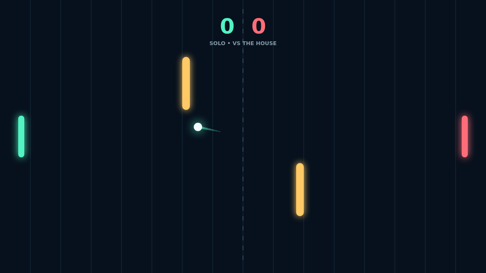

Carom is a fast paddle duel played across a dark, luminous field. Start a Solo match against the house or face a friend in local Versus, then send the ball back before it slips past your paddle.

Rallies build speed with every paddle hit. A clean center strike sends the ball straight across; meeting it near an edge changes the angle and gives you a chance to pull the opponent out of position.

Your paddle's motion adds spin. Move into contact to curve the ball through the rally, or hold your ground and play a steady return. The two gold obstacles turn the open field into a bank-shot puzzle: read the rebound and find a lane your opponent cannot cover.

A match is first to eleven, with a two-point lead required. Every point starts a fresh serve, and every rally gives you another chance to turn a small angle into match point.

